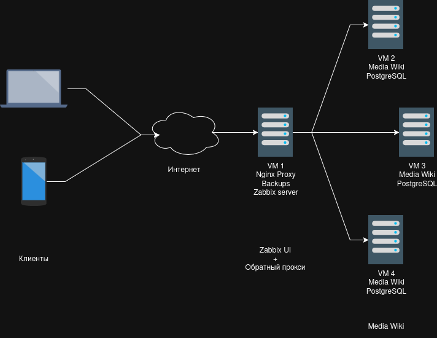

# Авто развёртывание MediaWiki на Yandex Cloud 

[Требования к проекту](Project_Requirements.md) | [Инструкция по установке](Installation.md) | [Инструкция по устранению неисправностей](Errors.md)

## Terraform
Terraform сам создаёт на Yandex Cloud 2+ машины для:
 * MediaWiki 
 * PostgreSQL

Также 1 машину для:
 * Обратный прокси Nginx
 * Zabbix сервер

Так же создаёт `inventory.yml` для Ansible.

## Ansible

Ниже представлены таги и что делают таски с этими тагами.

### default_packages
1. Устанавливаются стандартные пакеты на все машины.
 
### nginx_proxy
2. Устанавливается nginx.
3. Создаётся nginx.conf.
4. Заменяется nginx.conf.

### wiki_server
Таг для полной настройки веб-серверов MediaWiki. Включает следующие таги:
* **wiki_server_first_installation**
5. Устанавливаются пакеты.
6. Устанавливается MediaWiki.
7. Настраивается БД PostgreSQL.
* **wiki_server_LS**
8. Запрашивается LocalSettings.php.
9. На все машины с wiki добавляется LocalSettings.php.

### wiki_server_db
Таг для настройки кластера баз данных. Включает следующие таги:
* **wiki_server_main_db**
10. Добавляется syncuser и wikiuser в pg_hba.conf.
11. Создаётся syncuser пользователь для БД.
12. Настраивается postgresql.conf.
* **wiki_server_replica_db**
13. Останавливается PostgreSQL.
14. Удаляется старая БД.
15. Копируется БД и переводится в режим реплики.
16. Перезагружается PostgreSQL.

### backup_scripts
17. Копируются скрипты для резервного копирования файловой системы MediaWiki и PostgreSQL на сервер бэкапов.
18. Настраиваются SSH-ключи для беспарольного доступа к целевым серверам.
19. Добавляются задания автоматического бэкапа в планировщик cron.

### zabbix_server
20. На прокси-сервер устанавливается СУБД PostgreSQL для Zabbix.
21. Создаются база данных и пользователь zabbix, импортируется начальная схема данных.
22. Устанавливаются компоненты Zabbix Server, веб-интерфейс (Frontend) и PHP 8.3.
23. Конфигурируется Nginx для работы Zabbix UI.

### zabbix_host
24. На все целевые машины (серверы с MediaWiki) устанавливается zabbix-agent.
25. Агенты настраиваются на отправку метрик в сторону центрального Zabbix-сервера.

---

Таг `update` объединяет в себе таски обновлений конфигураций прокси, репликации, скриптов бэкапа и агентов мониторинга. Он позволяет перезаписать файлы, в которых используются IP-адреса хостов. Полезно, когда IP у машин динамический.
  
## Скрипты резервного копирования

Оба скрипта разворачиваются на сервере бэкапов и при запуске берут данные с удаленных хостов и сохраняют на той же машине. Списки целевых серверов генерируются автоматически через Ansible из роли `backup_scripts`.

### DB_Backup.sh

Резервное копирование базы данных PostgreSQL происходит следующим образом:
1. Скрипт через SSH запрашивает `hostname` удаленного сервера.
2. Проверяется доступность PostgreSQL и утилиты `pg_dump` под пользователем `postgres`.
3. Запускается `pg_dump` на удаленной машине, сохраняется через `gzip` в локальный архив на сервере бэкапов.
4. На сервере бэкапов удаляются архивы этой БД старше установленного срока.

#### Основные переменные и аргументы
* **Аргументы командной строки**:
  * `$1` (`DB_NAME`) — Имя базы данных (Обязательный).
  * `$2` (`DB_USER`) — Пользователь БД (Опциональный, Default: `postgres`).

| Переменная       | Пояснение                      | Комментарий                   |
| ---------------- | ------------------------------ | ----------------------------- |
| `DB_SERVERS`     | Адреса машин                   | Генерируется из Ansible       |
| `BACKUP_ROOT`    | Директория бэкапов             | `/home/user/backups/postgres` |
| `RETENTION_DAYS` | Срок хранения дампов БД (дней) | `30`                          |

---

### MediaWiki_Backup.sh

Резервное копирование файловой системы MediaWiki происходит следующим образом:
1. Скрипт через SSH запрашивает `hostname` удаленного веб-сервера.
2. Проверяется существование и доступность целевой директории на удаленной машине.
3. Папка архивируется на сервере с MediaWiki и передается через SSH в локальный архив на сервере бэкапов.
4. На сервере бэкапов удаляются архивы файловой системы старше установленного срока.

#### Основные переменные и аргументы
* **Аргументы командной строки**:
  * `$1` (`REMOTE_DIR`) — Путь к удаленной директории MediaWiki на целевых машинах (Обязательный).

| Переменная       | Пояснение                       | Комментарий                    |
| ---------------- | ------------------------------- | ------------------------------ |
| `TARGET_SERVERS` | Адреса машин                    | Генерируется из Ansible        |
| `BACKUP_ROOT`    | Директория бэкапов              | `/home/user/backups/mediawiki` |
| `RETENTION_DAYS` | Срок хранения архивов ФС (дней) | `14`                           |
